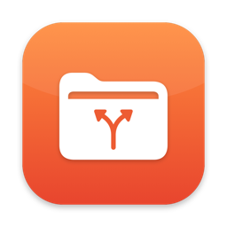

<p align="center"></p>

<h1 align="center">Gitty</h1>

<p align="center">A macOS app that works with Git repositories like a file manager<br>Your folders on the left, a Git repository on the right. Drag across, and the commit and push are done.</p>

<p align="center">
  <a href="https://github.com/eddieee-git/mac-app-gitty/releases/latest">Download the latest version</a> ·
  <a href="#install">Install</a> ·
  <a href="#how-to-use">How to use</a> ·
  <a href="#shortcuts">Shortcuts</a> ·
  <a href="#faq">FAQ</a> ·
  <a href="CHANGELOG.en.md">Changelog</a> ·
  <a href="README.md">한국어</a>
</p>

## Features

- **Two panes, like a file explorer**: your Mac on the left, a Git repository on the right. Each pane shows a folder tree next to a file list.
- **Finder-style favorites and locations**: Google Drive, iCloud Drive, Dropbox, OneDrive and external drives show up automatically. Add, remove and reorder favorites.
- **Drag to transfer**: left → right uploads, right → left downloads. You can drag straight from Finder too.
- **Drop onto a folder**: drop on a folder in the list or tree to put files inside it. Dropping within the same pane moves them.
- **No git knowledge needed**: upload, delete, rename, move and new folder are all committed and pushed right away.
- **Large files too**: files over 100 MB go up through Git LFS automatically. Copy and push progress is shown.
- **Automatic sync**: checks the remote every few minutes and brings in changes made elsewhere.
- **Search**: finds names down through subfolders.
- **Progress log**: what was uploaded and downloaded shows live at the bottom of the window and is kept in a file.
- **Copy with the middle arrows**: ▶ my folder → Git, ◀ Git → my folder. The ⇄ button compares the two folders and makes one match the other.
- **Safe uploads**: asks first for files that look secret (`.env`, SSH keys, certificates) and when uploading to a public repository.
- **File status badges**: files edited directly in the repository folder, files not in Git, files not yet pushed, and large files not yet downloaded are marked.
- **Tabs and views**: ⌘T opens a tab so you can work with several repositories. Choose list or icon (thumbnail) view, and a side-by-side or stacked folder tree, per pane.
- **Keyboard**: Tab switches panes, Return opens, ⌘↑ goes up, ⌘⌫ deletes, and typing jumps to that name.
- **Conflict resolution**: if the same file changed on another Mac, choose mine / theirs / keep both for each file.
- **Quick Look**: select a file and press Space, like in Finder.
- **Undo and history**: undo the last Git action with ⌥⌘Z; right-click a file → **History…** to open or restore an earlier version.
- **Private repositories**: signs in through the GitHub CLI (`gh`). No token to paste.
- **In-app updates**: tells you about new versions, checks the signature, and swaps them in.
- **English and Korean**: follows your Mac's language at first; change it in Settings.

## Install

Requires macOS 14 (Sonoma) or later. Apple silicon and Intel Macs are both supported.

1. Download `Gitty-x.y.z.dmg` from [Releases](https://github.com/eddieee-git/mac-app-gitty/releases/latest) and open it.
2. Drag **Gitty** into **Applications**.
3. Open Gitty. It has no Apple Developer signature, so macOS blocks the first launch. Click **Done**, then:
   - **macOS 15 (Sequoia) or later**: System Settings → Privacy & Security, scroll to the bottom, click **Open Anyway** next to Gitty, then **Open**.
   - **macOS 14 (Sonoma)**: right-click Gitty in Applications → **Open**.

   If you prefer Terminal: `xattr -dr com.apple.quarantine /Applications/Gitty.app`
4. On first launch Gitty tells you which tools are missing. Install only what you need.
   - **git**: run `xcode-select --install` in Terminal (skip if `git --version` already works)
   - **GitHub CLI**: needed to list private repositories and push.
     ```bash
     brew install gh
     gh auth login
     ```
   - **Git LFS** (only for files over 100 MB): `brew install git-lfs`

After that, Gitty tells you about new versions. You can also check with **Gitty → Check for Updates…**.

## How to use

1. Click **Open GitHub repository…** and pick a repository. The first time, it is cloned to your Mac.
   If you already have a clone, use **Open local clone…**.
2. Browse to your folder in the left pane and to a folder inside the repository in the right pane.
3. Drag files to the other pane, or use the **Copy to Git →** / **← Copy to my folder** buttons above the panes.
   Drop on a folder row (list or tree) to put files inside it.
4. Right-click to move, rename, delete or add to favorites.
5. Type in the search box above a pane to search subfolders. Press esc to clear.

## Shortcuts

| Key | Action |
|---|---|
| ⌘R | Sync with the remote (pull, pending pushes) |
| ⌘O | Choose files to upload to Git |
| ⌘, | Settings |
| Space | Quick Look |
| ⌥⌘→ / ⌥⌘← | Copy the selection to Git / to my folder |
| Tab | Switch between the left and right panes |
| ⌘↑ / ⌘↓ | Parent folder / Open |
| ⌘T / ⌘N | New tab / New window |
| ⌥⌘Z | Undo the last Git action |
| ⌥⌘L | Full activity log |
| ⌘⌫ | Delete the selection (Git asks first; my folder goes to the Trash) |
| Double-click | Open a folder; copy a file to the other side (my folder → Git uploads, Git → my folder downloads). Asks once the first time; you can switch it to "Open" in Settings |
| Return | Open a file |

## Settings

| Setting | What it does |
|---|---|
| Automatic sync | Off / every 1 · 5 · 15 · 30 minutes: checks the remote, pulls changes and sends pending pushes (5 minutes by default) |
| Download large files only when opened or copied | Doesn't fetch every large (LFS) file up front, so repositories open faster (off by default) |
| Language | Follow system / 한국어 / English. Reopen Gitty to apply |
| Check for new versions automatically | Checks GitHub once a day (on by default) |
| Install new versions automatically | Installs a found update by itself and relaunches while you aren't using Gitty (on by default) |
| Keep the activity log in a file | Records uploaded and downloaded file names and paths in `~/Library/Logs/Gitty` |

## FAQ

**What does it send?**
Only one request to GitHub's public API asking for the latest release, when checking for updates. Turn off automatic checks in Settings and not even that is sent. Everything else is what git and the GitHub CLI exchange with GitHub for the repositories you open (clone, pull, push). Gitty stores no GitHub token.

**Where are repositories cloned?**
In `~/Library/Application Support/Gitty/Repos/`. Gitty commits only the files from its own actions. Files you put in the clone folder yourself and Finder's `.DS_Store` are not uploaded.

**Can I upload files over 100 MB?**
Yes. GitHub doesn't accept files over 100 MB through plain git, so they go through Git LFS: up to 2 GB per file, and 1 GB of LFS storage on GitHub's free plan.

**Are deleted files gone for good?**
No. They stay in the git history. Files overwritten or deleted on the my-folder side go to the Trash.

**New folders get a `.gitkeep` file.**
git doesn't store empty folders, so a hidden `.gitkeep` file is added to new ones.

**A push failed.**
The status bar shows "unpushed commits". Click **Retry**. Long operations can be stopped with **Cancel** in the status bar; before the commit, everything is put back.

**Where do I look when something goes wrong?**
The activity log is at `~/Library/Logs/Gitty/gitty.log`. ⌥⌘L shows it in the app.

**macOS asks for permission when I open a folder.**
The first time you open Desktop, Documents, Downloads or Google Drive, macOS asks for access. Allow it once.

## Uninstall

1. **Gitty → Quit Gitty**
2. Move Gitty from Applications to the Trash
3. (Optional) To remove cloned repositories too, delete `~/Library/Application Support/Gitty`; for logs, `~/Library/Logs/Gitty`. Settings: `defaults delete com.eddieee.Gitty`

## Build from source

Requires macOS 14 or later and the Xcode Command Line Tools (Xcode itself isn't needed).

```bash
./scripts/test.sh           # behavior tests (local repositories only; nothing is sent to GitHub)
./scripts/build-app.sh      # build/Gitty.app + build/Gitty-<version>.dmg
open build/Gitty.app
```

Update signing keys and the release steps are described in [CLAUDE.md](CLAUDE.md) (Korean).

## License

[MIT](LICENSE)

<!-- more-apps:start -->
## More apps

| | App | |
|---|---|---|
|  | [Clocky](https://github.com/eddieee-git/mac-app-clocky) | Flip-clock timers, alarms and calendar alerts from the menu bar |
|  | [Floaty](https://github.com/eddieee-git/mac-app-floaty) | Floating sticky notes, right from the menu bar |
|  | [Grabby](https://github.com/eddieee-git/mac-app-grabby) | Capture, mark it up in place, and paste right away |
|  | [Peeky](https://github.com/eddieee-git/mac-app-peeky) | Bring back menu bar icons hidden behind the notch |
<!-- more-apps:end -->
