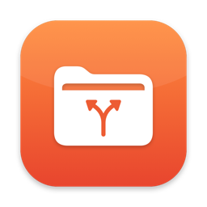

<p align="center">
  
</p>

<h1 align="center">Gitty</h1>

<p align="center">Git 저장소를 파일 관리자처럼 다루는 macOS 앱<br>왼쪽은 내 폴더, 오른쪽은 Git 저장소. 끌어다 놓으면 커밋·push까지 끝나요.</p>

<p align="center">
  <a href="https://github.com/eddieee-git/mac-app-gitty/releases/latest">최신 버전 내려받기</a> ·
  <a href="#설치">설치</a> ·
  <a href="#쓰는-방법">쓰는 방법</a> ·
  <a href="#알아두면-좋은-점">알아두면 좋은 점</a>
</p>

## 특징

- **탐색기 같은 두 패널**: 왼쪽에 내 Mac, 오른쪽에 Git 저장소. 패널마다 폴더 트리와 파일 목록이 나란히 보여요.
- **Finder 같은 즐겨찾기와 위치**: Google Drive, iCloud Drive, Dropbox, OneDrive, 외장 드라이브가 자동으로 나와요. 즐겨찾기는 추가·제거·순서 변경이 돼요.
- **끌어다 놓기로 주고받기**: 왼쪽 → 오른쪽은 업로드, 오른쪽 → 왼쪽은 내려받기예요. Finder에서 바로 끌어다 놓아도 돼요.
- **폴더 위에 놓기**: 목록이나 트리의 폴더 위에 놓으면 그 안으로 들어가요. 같은 패널 안에서 놓으면 이동이에요.
- **git을 몰라도 돼요**: 업로드, 삭제, 이름 변경, 이동, 새 폴더가 모두 바로 커밋·push 돼요.
- **큰 파일도**: 100MB가 넘는 파일은 자동으로 Git LFS로 올려요. 복사·push 진행률이 보여요.
- **자동 동기화**: 몇 분마다 원격을 확인해서 다른 곳에서 올린 변경을 받아 와요.
- **검색**: 하위 폴더까지 이름으로 찾아요.
- **진행 로그**: 무엇을 올리고 받았는지 창 아래에 실시간으로 보이고, 파일로도 남아요.
- **되돌리기와 변경 기록**: 마지막 Git 작업을 ⌥⌘Z로 되돌리고, 파일 오른쪽 클릭 → **변경 기록…**에서 지난 버전을 열거나 그 버전으로 되돌려요.
- **자동 업데이트**: 새 버전이 나오면 알려 주고 내려받아 줘요. 설정에서 켜면 종료할 때 알아서 설치해요.
- **private 저장소 지원**: GitHub CLI(`gh`)에 로그인한 계정으로 인증해요. 토큰을 따로 넣을 필요가 없어요.

## 설치

1. [Releases](https://github.com/eddieee-git/mac-app-gitty/releases/latest)에서 `Gitty-x.y.z.dmg`를 내려받아 열어요.
2. **Gitty**를 **Applications** 폴더로 끌어다 놓아요.
3. Gitty를 열어요. Apple 개발자 서명이 없는 앱이라 처음 한 번은 열 수 없다는 경고가 나와요. **완료**를 누른 뒤:
   - **macOS 15(Sequoia) 이상**: 시스템 설정 → 개인정보 보호 및 보안을 맨 아래까지 내려서 Gitty 옆의 **그래도 열기**를 누르고, 한 번 더 **열기**를 눌러요.
   - **macOS 14(Sonoma)**: 응용 프로그램 폴더에서 Gitty를 **오른쪽 클릭 → 열기**를 눌러요.

   터미널이 편하면 `xattr -dr com.apple.quarantine /Applications/Gitty.app`을 실행해도 돼요.

그다음부터는 Gitty가 새 버전을 알려 줘요. 메뉴 **Gitty → 업데이트 확인…**으로 직접 확인할 수도 있어요.

### 필요한 것

- macOS 14(Sonoma) 이상, Apple 실리콘과 Intel Mac 모두 지원해요.
- **git**: 터미널에서 `xcode-select --install`로 Command Line Tools를 설치해요. (이미 `git --version`이 되면 건너뛰어요)
- **GitHub CLI**: private 저장소 목록을 보고 push하려면 필요해요.
  ```bash
  brew install gh
  gh auth login
  ```
- **Git LFS** (100MB 넘는 파일을 올릴 때만): `brew install git-lfs`

## 쓰는 방법

1. **GitHub 저장소 열기…**를 눌러 목록에서 저장소를 골라요. 처음 열 때 내 Mac으로 클론해요.
   이미 클론해 둔 폴더가 있으면 **로컬 클론 열기…**로 열어도 돼요.
2. 왼쪽 패널에서 내 폴더를 찾아가고, 오른쪽 패널에서 Git 저장소 안의 폴더를 찾아가요.
3. 파일을 반대쪽 패널로 끌어다 놓거나, 패널 위의 **Git으로 복사 →** / **← 내 폴더로 복사** 버튼을 눌러요.
   폴더 줄(목록·트리) 위에 놓으면 그 폴더 안으로 들어가요.
4. 오른쪽 클릭 메뉴에서 이동, 이름 변경, 삭제, 즐겨찾기 추가를 할 수 있어요.
5. 패널 위쪽 검색 상자에 이름을 넣으면 하위 폴더까지 찾아요. Esc로 지워요.

| 단축키 | 동작 |
|---|---|
| ⌘R | 원격과 동기화 (pull, 밀린 push) |
| ⌘O | 파일 골라서 Git에 업로드 |
| ⌘, | 설정 (자동 동기화 간격, 업데이트, Git LFS 상태) |
| ⌥⌘Z | 마지막 Git 작업 되돌리기 |
| ⌥⌘L | 전체 작업 기록 |
| ⌫ (Delete) | 선택 항목 삭제 (Git은 확인 후, 내 폴더는 휴지통으로) |
| 더블클릭 | 폴더 열기 / 파일 열기 |

## 알아두면 좋은 점

- 저장소는 `~/Library/Application Support/Gitty/Repos/`에 클론돼요. Gitty는 자기가 한 작업의 파일만 커밋해요. 클론 폴더에 직접 넣은 파일이나 Finder의 `.DS_Store`는 올라가지 않아요.
- GitHub는 100MB가 넘는 파일을 일반 git으로 받지 않아서 Git LFS로 올려요. 파일 하나 2GB까지, GitHub 무료 요금제의 LFS 용량은 1GB예요.
- git은 빈 폴더를 저장하지 않아서, 새 폴더에는 숨김 파일 `.gitkeep`이 들어가요.
- 삭제해도 git 히스토리에는 남아 있어요. 내 폴더 쪽에서 덮어쓰거나 지운 파일은 휴지통으로 가요.
- push에 실패하면 아래 상태 표시줄에 "push 안 된 커밋"이 보여요. **다시 시도**를 누르면 돼요.
- 작업 기록은 `~/Library/Logs/Gitty/gitty.log`에 있어요. 문제가 생기면 이 파일을 보면 원인을 알 수 있어요.
- 업데이트는 6시간마다 GitHub 릴리스를 확인하고, 설치 전에 서명을 확인해요. **업데이트를 자동으로 설치**를 켜면 새 버전을 미리 받아 두었다가 Gitty를 종료할 때 바꿔 끼워요(응용 프로그램 폴더처럼 쓰기 권한이 있는 곳에 설치했을 때).
- 데스크탑·문서·다운로드·Google Drive를 처음 열면 macOS가 접근 허용을 물어요. 한 번 허용하면 돼요.

## 빌드

Xcode 없이 Command Line Tools만으로 빌드해요.

```bash
./scripts/build-app.sh      # build/Gitty.app, build/Gitty-<버전>.dmg
./scripts/release.sh        # 태그를 달고 GitHub 릴리스에 dmg와 서명(.sig) 첨부
./scripts/test.sh           # 동작 시험 (로컬 저장소로, GitHub에 아무것도 안 보냄)
./scripts/make-icon.sh      # 앱 아이콘 다시 그리기 (Resources/AppIcon.icns)
```

버전은 `Resources/Info.plist`의 `CFBundleShortVersionString`, 릴리스 노트는 `docs/releases/v<버전>.md`에 써요.

### 업데이트 서명

앱은 업데이트 dmg를 설치하기 전에 Ed25519 서명을 확인해요. 공개 키는 `Resources/Info.plist`의 `GittyUpdatePublicKey`에, 비밀 키는 릴리스하는 Mac의 로그인 키체인("Gitty Update Signing")에만 있어요. 그래서 GitHub 계정이나 릴리스가 털려도 가짜 dmg는 설치되지 않아요. 서명 파일이 없거나 맞지 않는 릴리스는 받지 않아요.

```bash
swift scripts/update-signing.swift public-key   # 키체인의 키로 공개 키 확인
swift scripts/update-signing.swift keygen       # 새 키 만들기 (처음 한 번)
```

비밀 키를 잃어버리면 새 키를 넣은 버전을 사용자가 한 번 직접 설치해야 해요. 키체인 접근에서 항목을 백업해 두세요.

## 라이선스

MIT
