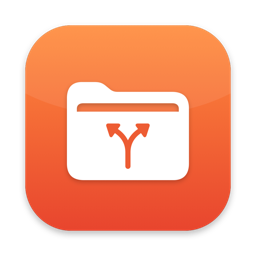

<p align="center"></p>

<h1 align="center">Gitty</h1>

<p align="center">Git 저장소를 파일 관리자처럼 다루는 macOS 앱<br>왼쪽은 내 폴더, 오른쪽은 Git 저장소. 끌어다 놓으면 커밋·push까지 끝나요.</p>

<p align="center">
  <a href="https://github.com/eddieee-git/mac-app-gitty/releases/latest">최신 버전 내려받기</a> ·
  <a href="#설치">설치</a> ·
  <a href="#쓰는-방법">쓰는 방법</a> ·
  <a href="#단축키">단축키</a> ·
  <a href="#자주-묻는-질문">자주 묻는 질문</a> ·
  <a href="CHANGELOG.md">변경 기록</a> ·
  <a href="README.en.md">English</a>
</p>

## 특징

- **탐색기 같은 두 패널**: 왼쪽에 내 Mac, 오른쪽에 Git 저장소. 패널마다 폴더 트리와 파일 목록이 나란히 보여요.
- **Finder 같은 즐겨찾기와 위치**: Google Drive, iCloud Drive, Dropbox, OneDrive, 외장 드라이브가 자동으로 나와요. 즐겨찾기는 추가·제거·순서 변경이 돼요.
- **끌어다 놓기로 주고받기**: 왼쪽 → 오른쪽은 업로드, 오른쪽 → 왼쪽은 내려받기예요. Finder에서 바로 끌어다 놓아도 돼요.
- **폴더 위에 놓기**: 목록이나 트리의 폴더 위에 놓으면 그 안으로 들어가요. 같은 패널 안에서 놓으면 이동이에요.
- **git을 몰라도 돼요**: 업로드, 삭제, 이름 변경, 이동, 새 폴더가 모두 바로 커밋·push 돼요.
- **큰 파일도**: 100MB가 넘는 파일은 자동으로 Git LFS로 올려요. 복사·push 진행률이 보여요.
- **자동 동기화**: 몇 분마다 원격을 확인해서 다른 곳에서 올린 변경을 받아 와요.
- **검색**: 하위 폴더까지 이름으로 찾아요.
- **진행 로그**: 무엇을 올리고 받았는지 창 아래에 실시간으로 보이고, 파일로도 남아요.
- **가운데 화살표로 복사**: ▶ 내 폴더 → Git, ◀ Git → 내 폴더. 가운데 ⇄ 단추는 두 폴더를 비교해서 한쪽을 다른 쪽과 같게 맞춰요(폴더 맞추기).
- **안전하게 올리기**: `.env`, SSH 키, 인증서처럼 비밀 정보가 들어 있을 법한 파일, 내용에 키·토큰이 적힌 파일, 공개 저장소에 올릴 때는 먼저 물어봐요.
- **파일 상태 표시**: 저장소 폴더에서 직접 고친 파일, Git에 없는 파일, 아직 안 올라간 파일, 아직 안 받은 큰 파일에 표시가 붙어요.
- **탭과 보기 방식**: ⌘T로 탭을 열어 저장소를 여러 개 다뤄요. 목록 보기와 아이콘(미리보기) 보기, 폴더 트리 좌우·위아래 배치를 패널마다 고를 수 있어요.
- **키보드**: Tab으로 패널 오가기, Return 열기, ⌘↑ 상위 폴더, ⌘⌫ 삭제, 글자를 치면 그 이름으로 이동.
- **충돌 정리**: 다른 Mac에서 같은 파일을 바꿨으면 파일마다 내 것 / 원격 것 / 둘 다 남기기를 골라요.
- **미리 보기**: 파일을 고르고 스페이스바를 누르면 Finder처럼 바로 보여요.
- **되돌리기와 변경 기록**: 마지막 작업(Git 쪽, 내 폴더 쪽 모두)을 ⌥⌘Z로 되돌리고, 파일 오른쪽 클릭 → **변경 기록…**에서 지난 버전을 열거나 그 버전으로 되돌려요.
- **더블클릭으로 주고받기**: 내 폴더의 파일을 더블클릭하면 Git으로 올리고, Git의 파일을 더블클릭하면 내 폴더로 받아요(설정에서 "열기"로 바꿀 수 있어요).
- **Git 휴지통과 브랜치**: 지운 파일을 골라 되살리고, Git 패널에서 브랜치를 바꾸거나 새로 만들어요.
- **새 저장소 만들기**: 첫 화면에서 이름만 넣으면 비공개 저장소를 만들고 바로 열어요.
- **저장소 용량 표시**: 저장소와 LFS 크기가 보이고, GitHub 권장 크기(1GB)에 가까워지면 알려 줘요.
- **이어서 쓰기**: 다시 켜면 탭마다 지난 저장소와 폴더가 열리고, 바쁠 때 놓은 작업은 차례대로 해요.
- **private 저장소 지원**: GitHub CLI(`gh`)에 로그인한 계정으로 인증해요. 토큰을 따로 넣을 필요가 없어요.
- **앱 안 업데이트**: 새 버전이 나오면 알려 주고, 서명을 확인한 뒤 바꿔 넣어요.
- **한국어·영어**: 처음에는 Mac의 언어를 따르고, 설정에서 바꿀 수 있어요.

## 설치

macOS 14(Sonoma) 이상이 필요해요. Apple 실리콘과 Intel Mac 모두 지원해요.

1. [Releases](https://github.com/eddieee-git/mac-app-gitty/releases/latest)에서 `Gitty-x.y.z.dmg`를 내려받아 열어요.
2. **Gitty**를 **Applications** 폴더로 끌어다 놓아요.
3. Gitty를 열어요. Apple 개발자 서명이 없는 앱이라 처음 한 번은 열 수 없다는 경고가 나와요. **완료**를 누른 뒤:
   - **macOS 15(Sequoia) 이상**: 시스템 설정 → 개인정보 보호 및 보안을 맨 아래까지 내려서 Gitty 옆의 **그래도 열기**를 누르고, 한 번 더 **열기**를 눌러요.
   - **macOS 14(Sonoma)**: 응용 프로그램 폴더에서 Gitty를 **오른쪽 클릭 → 열기**를 눌러요.

   터미널이 편하면 `xattr -dr com.apple.quarantine /Applications/Gitty.app`을 실행해도 돼요.
4. 처음 열면 빠진 도구가 있는지 알려 줘요. 필요한 것만 설치하면 돼요.
   - **git**: 터미널에서 `xcode-select --install` (이미 `git --version`이 되면 건너뛰어요)
   - **GitHub CLI**: private 저장소 목록을 보고 push하려면 필요해요.
     ```bash
     brew install gh
     gh auth login
     ```
   - **Git LFS** (100MB 넘는 파일을 올릴 때만): `brew install git-lfs`

그다음부터는 Gitty가 새 버전을 알려 줘요. 메뉴 **Gitty → 업데이트 확인…**으로 직접 확인할 수도 있어요.

## 쓰는 방법

1. **GitHub 저장소 열기…**를 눌러 목록에서 저장소를 골라요. 처음 열 때 내 Mac으로 클론해요.
   이미 클론해 둔 폴더가 있으면 **로컬 클론 열기…**로 열어도 돼요.
2. 왼쪽 패널에서 내 폴더를 찾아가고, 오른쪽 패널에서 Git 저장소 안의 폴더를 찾아가요.
3. 파일을 반대쪽 패널로 끌어다 놓거나, 패널 위의 **Git 저장소로 복사 →** / **← 내 폴더로 복사** 버튼을 눌러요.
   폴더 줄(목록·트리) 위에 놓으면 그 폴더 안으로 들어가요.
4. 오른쪽 클릭 메뉴에서 이동, 이름 변경, 삭제, 즐겨찾기 추가를 할 수 있어요.
5. 패널 위쪽 검색 상자에 이름을 넣으면 하위 폴더까지 찾아요. esc로 지워요.

## 단축키

| 키 | 동작 |
|---|---|
| ⌘R | 원격과 동기화 (pull, 밀린 push) |
| ⌘O | 파일 골라서 Git에 업로드 |
| ⌘, | 설정 |
| 스페이스 | 미리 보기 (Quick Look) |
| ⌥⌘→ / ⌥⌘← | 고른 항목을 Git으로 / 내 폴더로 복사 |
| Tab | 왼쪽·오른쪽 패널 오가기 |
| ⌘↑ / ⌘↓ | 상위 폴더 / 열기 |
| ⌘T / ⌘N | 새 탭 / 새 창 |
| ⌥⌘Z | 마지막 Git 작업 되돌리기 |
| ⌥⌘L | 전체 작업 기록 |
| ⌘⌫ | 선택 항목 삭제 (Git은 확인 후, 내 폴더는 휴지통으로) |
| 더블클릭 | 폴더는 열기, 파일은 반대쪽으로 복사 (내 폴더 → Git 올리기, Git → 내 폴더 받기). 처음 한 번 묻고, 설정에서 "열기"로 바꿀 수 있어요 |
| Return | 파일 열기 |

## 설정

| 항목 | 설명 |
|---|---|
| 자동 동기화 | 끄기 / 1 · 5 · 15 · 30분마다 원격을 확인해 변경을 받아 오고 밀린 push를 보내요(기본 5분) |
| 큰 파일은 열거나 복사할 때만 받기 | 큰 파일(LFS)을 미리 다 받지 않아 저장소가 빨리 열려요(기본 끔) |
| 언어 | 시스템 설정 따르기 / 한국어 / English. 바꾸면 Gitty를 다시 열어야 적용돼요 |
| 새 버전 자동으로 확인 | 하루 한 번 GitHub에서 새 버전을 확인해요(기본 켬) |
| 새 버전 자동으로 설치 | 확인한 새 버전을 Gitty를 쓰지 않을 때 알아서 설치하고 다시 켜요(기본 켬) |
| 파일 더블클릭 | 반대쪽으로 복사 / 열기. 처음 더블클릭할 때 한 번 물어요 |
| 올리기 전에 커밋 메시지 쓰기 | 켜면 올리기 전에 메시지를 직접 써요(기본 끔, 꺼 두면 자동으로 써요) |
| 작업 기록을 파일로 남기기 | 올리고 받은 파일 이름과 경로를 `~/Library/Logs/Gitty`에 남겨요 |

## 자주 묻는 질문

**어떤 정보를 보내나요?**
업데이트 확인 때 GitHub 공개 API에 최신 릴리스를 묻는 요청 하나만 보내요. 설정에서 자동 확인을 끄면 그것도 보내지 않아요. 그 밖에는 사용자가 연 저장소에 대해 git과 GitHub CLI가 GitHub와 주고받는 것(clone, pull, push)뿐이에요. Gitty는 GitHub 토큰을 저장하지 않아요.

**저장소는 어디에 받아지나요?**
`~/Library/Application Support/Gitty/Repos/`에 클론돼요. Gitty는 자기가 한 작업의 파일만 커밋해요. 클론 폴더에 직접 넣은 파일이나 Finder의 `.DS_Store`는 올라가지 않아요.

**100MB가 넘는 파일도 올릴 수 있나요?**
네. GitHub는 100MB가 넘는 파일을 일반 git으로 받지 않아서 Git LFS로 올려요. 파일 하나 2GB까지, GitHub 무료 요금제의 LFS 용량은 1GB예요.

**지운 파일은 완전히 사라지나요?**
아니요. 삭제해도 git 히스토리에는 남아 있어요. 내 폴더 쪽에서 덮어쓰거나 지운 파일은 휴지통으로 가요.

**새 폴더에 `.gitkeep`이 생겨요.**
git은 빈 폴더를 저장하지 않아서, 새 폴더에는 숨김 파일 `.gitkeep`을 넣어요.

**push에 실패했어요.**
아래 상태 표시줄에 "push 안 된 커밋"이 보여요. **다시 시도**를 누르면 돼요. 오래 걸리는 작업은 상태 표시줄의 **취소**로 멈출 수 있고, 커밋 전이면 원래대로 되돌려요.

**문제가 생기면 어디를 보나요?**
작업 기록이 `~/Library/Logs/Gitty/gitty.log`에 있어요. ⌥⌘L로 앱 안에서도 볼 수 있어요.

**폴더를 열 때 macOS가 허용을 물어요.**
데스크탑·문서·다운로드·Google Drive를 처음 열면 macOS가 접근 허용을 물어요. 한 번 허용하면 돼요.

## 지우기

1. **Gitty → Gitty 종료**
2. 응용 프로그램 폴더에서 Gitty를 휴지통으로
3. (선택) 받아 둔 저장소까지 지우려면 `~/Library/Application Support/Gitty`를, 작업 기록은 `~/Library/Logs/Gitty`를 지워요. 설정은 `defaults delete com.eddieee.Gitty`

## 직접 빌드하기

macOS 14 이상과 Xcode Command Line Tools가 필요해요(Xcode는 없어도 돼요).

```bash
./scripts/test.sh           # 동작 시험 (로컬 저장소로, GitHub에 아무것도 안 보냄)
./scripts/build-app.sh      # build/Gitty.app + build/Gitty-<버전>.dmg
open build/Gitty.app
```

업데이트 서명 키와 릴리스 방법은 [CLAUDE.md](CLAUDE.md)에 있어요.

## 라이선스

[MIT](LICENSE)

<!-- more-apps:start -->
## 다른 앱

| | 앱 | |
|---|---|---|
|  | [Clocky](https://github.com/eddieee-git/mac-app-clocky) | 메뉴바에서 꺼내 쓰는 넘김시계 타이머·알람·일정 알림 |
|  | [Floaty](https://github.com/eddieee-git/mac-app-floaty) | 메뉴바에서 바로 꺼내 쓰는 플로팅 스티커 메모 |
|  | [Grabby](https://github.com/eddieee-git/mac-app-grabby) | 찍고, 그 자리에서 그리고, 바로 붙여 넣는 화면 캡처 |
|  | [Keepy](https://github.com/eddieee-git/mac-app-keepy) | 복사한 내용을 모아 두고 다시 붙여 넣는 클립보드 기록 |
|  | [Mdy](https://github.com/eddieee-git/mac-app-mdy) | 더블클릭으로 바로 여는 마크다운 뷰어 겸 편집기 |
|  | [Peeky](https://github.com/eddieee-git/mac-app-peeky) | 노치에 가려진 메뉴바 아이콘을 꺼내 보는 앱 |
<!-- more-apps:end -->
